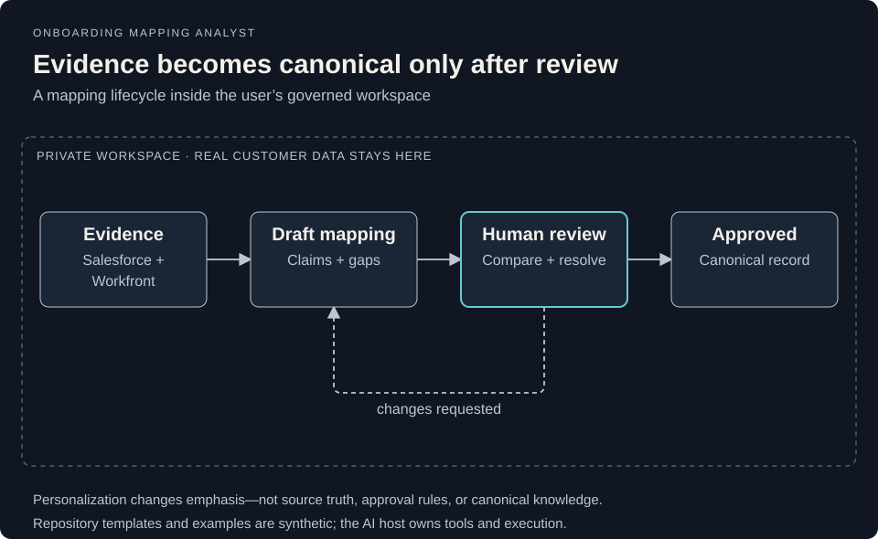

# Onboarding Mapping Analyst

**Evidence-led onboarding mappings, with a human approval boundary.**

A governed instruction and template toolkit for analyzing, comparing, explaining, and maintaining Salesforce and Adobe Workfront onboarding mappings in a user's existing AI workspace. It is not a hosted integration or an autonomous production writer.

## Start here

1. Read [00_START_HERE.md](00_START_HERE.md) and the [bootstrap checklist](08_Interface_Setup/BOOTSTRAP_CHECKLIST.md).
2. Select the setup for your existing Gemini, Gemini in Drive, or NotebookLM surface under `08_Interface_Setup/`.
3. Configure [the shared mapping workspace pointer](00_Workspace/SHARED_MAPPING_WORKSPACE.md) in your private deployment copy.
4. Supply authorized source material and a specific outcome. Keep customer data and operational outputs outside this repository.

For a packaged copy, use `dist/Onboarding_Mapping_Analyst_LATEST.zip` with its adjacent SHA-256 file. This is a branch-generated deployment bundle, not an immutable versioned release. Pin a reviewed commit for reproducibility. Updates to the source must pass safety checks before repackaging.

## What it helps with

| Intent | Result |
| --- | --- |
| Analyze, compare, or explain | Source-linked findings, gaps, and uncertainty |
| Generate from intake | A reviewable draft grounded in supplied requirements |
| Update a mapping | Explicit changes with version and approval boundaries |
| Discover a new mapping | A structured mapping proposal, not invented canonical truth |

The specialist identity is a **Senior Data Systems Analyst specialized in onboarding data mappings**. Skills define analytical capability; the user's host controls tools, model access, and execution authority.

## Architecture



Review can return a mapping to draft. Only approved evidence becomes canonical knowledge. The SVG is the editable source.


The decision order is **task intent → workspace → complexity/consequence → relevant skills → optional personalization → governance**. A custom workspace never silently changes shared canonical knowledge.

The [architecture diagram](docs/assets/architecture.svg), [knowledge model](docs/assets/knowledge_model.svg), and [solution guide](docs/Confluence_Solution_Guide.md) provide more detail.

## Project structure

| Path | Responsibility |
| --- | --- |
| `00_Workspace/` | Workspace selection, shared pointer, manifest/index templates |
| `01_Agent_Core/` | Identity, routing, governance, output and execution policies |
| `02_Skills/` | Modular mapping instructions |
| `03_Registries/` | Governed knowledge templates and generated workbook |
| `04_Source_Library/` | Source structure and synthetic examples |
| `05_Production_Evidence/` | Placeholder structure only; real evidence remains external |
| `06_Master_Mappings/` | Approved/draft lifecycle templates, not real operational mappings |
| `07_Analysis_Reviews/` | Human review guidance |
| `08_Interface_Setup/` | Existing-host setup and bootstrap |
| `09_Request_Outputs/` | Placeholder structure; real outputs remain external |
| `10_Personalization/` | Optional profile/lens resolution and templates |
| `scripts/`, `tests/` | Generation, public-safety checks, and regression tests |
| `dist/` | Intentional distributable package and checksum |

## Personalization without changing truth

Optional personalization can use no profile, a private profile, or an explicitly selected shared profile. A resolver may apply at most one shared lens and one personal analysis profile. Samples are never auto-selected.

Configure [the shared personalization pointer](10_Personalization/SHARED_PERSONALIZATION_LIBRARY.md) only in an authorized private workspace. Personalization changes emphasis and presentation, not mapping evidence, approval rules, or canonical truth.

## Verification

The scanner and regression suite are run from a **source checkout** and need Python 3.10+ and the standard library:

```bash
python -m unittest discover -s tests -v
python scripts/public_safety_scan.py --repo
python scripts/public_safety_scan.py --package dist/Onboarding_Mapping_Analyst_LATEST.zip
cd dist
sha256sum -c Onboarding_Mapping_Analyst_LATEST.sha256
```

The [package workflow](.github/workflows/build-latest-zip.yml) regenerates the workbook and Word guide, renders diagrams, validates publication content, and refreshes the ZIP/checksum. Those generation steps additionally require the tools declared in the workflow. The scanner rejects unsafe archive paths and known private identifiers; it is not a complete secret detector, DLP system, or proof of analytical correctness.

## Data and contribution policy

Only reusable instructions, governance, templates, and synthetic examples belong here. Real customer data, private service names, production mappings, credentials, internal links, operational outputs, and personal profiles stay in the governed external workspace. See [PUBLIC_REPOSITORY_DATA_POLICY.md](PUBLIC_REPOSITORY_DATA_POLICY.md).

Keep changes proportionate, preserve approval/version rules, and use synthetic test cases. Do not remove useful tests or delete the intentional `dist/` deliverable as build junk. No hosted package or supported runtime release is implied, and the source is licensed under the [MIT License](LICENSE). GitHub computes the Languages panel automatically from source content.
